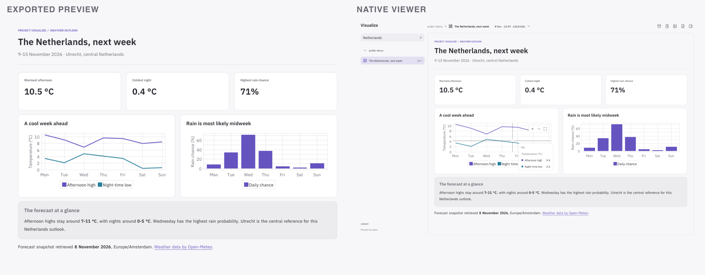

# Project Visualize

Give your agent a place to keep dashboards, diagrams and reports. Visualize saves them
in a searchable library, where you can explore the details, revisit earlier versions
and export the result.

<picture>
  <source media="(max-width: 760px)" srcset="docs/media/weather-workflow-mobile.png">
  
</picture>

A public weather forecast as an exported preview and in the native viewer.
[View the source](docs/media/netherlands-weather.json).

## What you can make

Combine charts, metrics, tables, rich text and images into a dashboard or document.
Draw process flows, state diagrams, trees, entity relationships, message sequences and
schedules. Add filters to explore a dataset, zoom into a chart or expand supporting
notes without losing the surrounding explanation.

Browse the [widget catalogue](examples/README.md) for runnable examples and their
HTML, PNG and PDF exports. The [complete examples](examples/) show how to compose
widgets into larger reports.

## Get started

Visualize runs on macOS and Linux. Build the application with the
[setup guide](docs/development.md#build), then open the desktop app. Linux package
installation is covered in the [Linux guide](docs/linux.md#installation).

Open **Settings** and use **Install CLI** to put `visualize` on your PATH. Use
**Link skill** to make the bundled workflow available to your agent. Both actions
let you choose a destination and preserve existing files. Keep the application at
its installed location so the links stay valid.

With the skill installed, ask your agent for a visualization:

> Visualize this week's observations. Compare the stations, show the trend and keep
> the source data with the report. Save it under the observatory project and include
> an image in your reply.

The agent creates a saved artifact and can return its image or interactive HTML in
chat. Open Visualize to explore the artifact and find it again later.

## Keep your work organized

Artifacts belong to projects. New revisions preserve earlier documents, assets and
snapshots, so an updated report keeps its history. Search the library by project,
artifact ID or title, and choose an earlier revision from the version menu.

Archive an artifact to remove it from ordinary browsing. Its revisions remain saved
and searchable; you can restore it from the viewer or CLI.

The viewer follows the revision marked for presentation. Agents can save newer drafts
without replacing that delivered view; choose **Follow latest** to inspect those drafts.
CLI commands navigate the existing viewer for the library and start one when needed.

Open **Contents** to find a section in a long report. Search headings or choose one to
jump to it, including sections inside collapsed notes. Cmd+Shift+O on macOS or
Ctrl+Shift+O on Linux opens the contents search.

## Share an artifact

- **PNG** gives you an image for chat, documents and slides, with desktop or phone
  layouts and a choice of pixel density.
- **PDF** paginates the report and preserves selectable document text and links.
- **HTML** gives you an offline page with interactive controls and charts. Fonts,
  images and data travel with the file.

Export a complete artifact or one whole widget or card. Exports stay organized in the
library unless you choose another destination. HTML is generated from Visualize's
structured artifacts; the library does not import arbitrary HTML pages.

## Use the CLI

From a source checkout, create and open an example with:

```sh
bin/visualize render --project observatory --artifact weekly-review \
  --file examples/observatory.json
bin/visualize open --project observatory --artifact weekly-review
bin/visualize export --project observatory --artifact weekly-review \
  --format html --out weekly-review.html
```

`render` returns the saved revision and image/PDF paths as JSON. Repeat it with the
same project and artifact IDs to create a revision. Add `--version` to open or export
an earlier one. Use `--width 390` for a phone layout or `--theme dark` for dark output.
Run `visualize --help` for commands, or read the [artifact guide](docs/artifacts.md)
for authoring, linked controls and partial exports.

## Your library

Artifacts stay on your machine. macOS uses
`~/Library/Application Support/Project Visualize`; Linux uses
`$XDG_DATA_HOME/project-visualize`, defaulting to `~/.local/share/project-visualize`.
Set `VISUALIZE_HOME` or pass `--store` to use a separate library.

Visualize uses Maligator and a native wgpu viewer. For build instructions, rendering
regressions and export updates, see [development](docs/development.md).
[Third-party notices](THIRD_PARTY.md) describe its dependencies.
